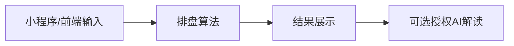

# Longyuanwenzhen-AI · ARCHITECTURE

核实日期：2026-10-15。依据本地README、构建清单和实际入口；本文件不把文档计划当成运行时验收。

## 目标与范围

维护微信小程序排盘与可选 AI 解读的应用，排盘与 AI 服务边界分别验收。

GitHub：[longyuanai/Longyuanwenzhen-AI](https://github.com/longyuanai/Longyuanwenzhen-AI)。知识笔记：Vault内 `03_Projects/Longyuanwenzhen-AI/Longyuanwenzhen-AI - Git关联.md`。

## 组件与代码入口

| 实际路径 | 责任边界 |
| --- | --- |
| [backend](backend) | 服务端 |
| [frontend](frontend) | 界面 |
| [miniprogram](miniprogram) | 微信小程序 |
| [docs](docs) | 工程规范与说明 |

## 数据与控制流

以下链路对应README/规范描述；实现覆盖以代码入口和适用验证为准。

## 构建与依赖依据

按README和各子目录清单运行；文档/静态/脚本项目不额外引入构建框架。

## 验证边界

使用脱敏日期样本验证时区、日期边界、空输入与错误处理；不使用机主出生资料。

## 现行依据

- [README.md](README.md)
